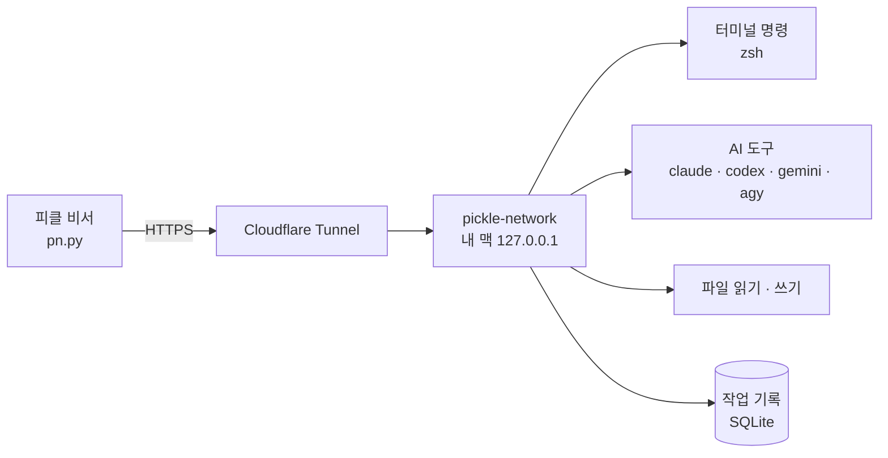

<div align="center">

# pickle-network

피클에게 말하면, 내 맥이 대신 일합니다.

[](https://github.com/hahmjuntae/pickle-network/actions/workflows/tests.yml)
[](LICENSE)

</div>

피클(Pickle) 비서가 내 맥의 터미널과 파일, Claude Code 같은 AI 도구를 쓸 수 있게 이어 주는 작은 서버입니다. 도메인이나 클라우드 계정 없이 맥 한 대로 시작할 수 있습니다.

## 할 수 있는 일

- 맥에서 터미널 명령 실행
- 맥의 파일 읽기, 쓰기
- 맥에 설치된 Claude Code, Codex, Gemini CLI에 작업 맡기기
- 오래 걸리는 작업의 진행 상황 확인, 취소

## 시작하기

macOS와 [Homebrew](https://brew.sh)가 필요합니다.

### 1. 설치

터미널에 붙여넣고 실행합니다.

```bash
brew install cloudflared
git clone https://github.com/hahmjuntae/pickle-network.git ~/pickle-network
~/pickle-network/bin/pickle-network setup
~/pickle-network/bin/pickle-network tunnel quick
```

마지막에 `https://...trycloudflare.com` 주소가 나오면 설치가 끝난 것입니다. 맥을 다시 켜도 자동으로 실행됩니다.

### 2. 피클 연결

1. 터미널에서 아래 명령을 실행하고, 출력된 문장을 피클에게 보냅니다.

   ```bash
   pickle-network pair
   ```

2. 피클이 보낸 공개키(`-----BEGIN PUBLIC KEY-----`부터 끝까지)를 복사한 뒤 실행합니다.

   ```bash
   pbpaste > ~/pickle.pub && pickle-network pair --key ~/pickle.pub --copy
   ```

3. 클립보드에 복사된 연결 메시지를 피클에게 보냅니다.

피클이 맥 이름과 AI 도구 목록을 알려 주면 연결이 끝난 것입니다.

## 사용 예시

피클에게 평소처럼 부탁하면 됩니다.

```text
내 맥에서 ~/projects/blog 테스트 돌려 보고, 실패하면 Claude Code로 고친 다음 결과 알려줘.
```

```text
내 맥 ~/Downloads 에 이번 주에 받은 PDF 목록을 크기순으로 보여줘.
```

```text
아까 맡긴 작업 아직 돌고 있어? 지금까지 나온 출력만 보여줘.
```

## 동작 방식



피클은 자기 작업 공간에서 `pn.py`라는 작은 프로그램으로 내 맥에 요청을 보냅니다. 요청은 Cloudflare Tunnel을 거쳐 맥에서만 열려 있는 서버(`127.0.0.1`)에 도착합니다. 공유기 포트를 열 필요가 없습니다.

### 요청 처리 흐름

1. 서버가 요청에 담긴 기기 토큰을 확인합니다. 토큰이 없거나 틀리면 거절합니다.
2. 작업을 대기열에 넣습니다. 최대 3개까지 동시에 실행됩니다.
3. 명령이나 AI 도구를 실행하고, 출력은 실행 중에도 파일에 기록합니다.
4. 피클은 작업이 끝날 때까지 기다렸다가 결과를 받습니다. 오래 걸리면 작업 ID로 다시 확인하거나 취소할 수 있습니다.

### 연결 순서

```text
맥                                        피클
pickle-network pair  ── 키 요청 문장 ──▶   python3 pn.py keygen
                     ◀──── 공개키 ─────
pair --key 공개키    ── 연결 메시지 ───▶   python3 pn.py connect 'pn1e....'
                                           python3 pn.py hello
```

연결 메시지에는 맥 주소와 기기 토큰이 들어 있고, 피클의 공개키로 암호화돼 있습니다. 대화 기록에 남아도 피클의 개인키가 없으면 열 수 없습니다.

### 데이터 위치

모든 데이터는 `~/.pickle-network`에 있고 본인만 읽을 수 있습니다.

```text
~/.pickle-network
├── config.json     설정 (포트, 허용 폴더, 터널)
├── devices.json    연결된 비서 목록 (토큰은 해시로만 저장)
├── jobs.sqlite3    작업 기록
├── jobs/           작업별 출력
├── keys/           터널 정보, 피클 공개키
└── logs/           서버, 접근, 터널 로그
```

작업 기록은 14일 뒤 자동으로 지워집니다. 더 자세한 내용은 [API 문서](docs/API.md)에 있습니다.

## 명령어

| 명령 | 설명 |
|---|---|
| `pickle-network status` | 상태와 외부 주소 확인 |
| `pickle-network doctor` | 연결 점검 |
| `pickle-network pair` | 피클 연결 메시지 만들기 |
| `pickle-network devices` | 연결된 비서 목록 |
| `pickle-network devices revoke pickle` | 피클 연결 끊기 |
| `pickle-network stop` / `start` | 멈추기, 다시 켜기 |
| `pickle-network uninstall --purge` | 완전히 지우기 |

## 자주 묻는 질문

<details>
<summary><b>Cloudflare 계정이나 도메인이 있어야 하나요?</b></summary>

없어도 됩니다. `tunnel quick`은 계정 없이 임시 주소를 만듭니다. 주소를 고정하고 싶을 때만 [내 도메인으로 연결하기](docs/DOMAIN.md)를 따르세요.

</details>

<details>
<summary><b>피클이 갑자기 접속을 못 해요.</b></summary>

임시 주소는 맥을 재시동하거나 터널을 다시 켜면 바뀝니다. 아래 명령의 출력을 피클에게 다시 보내 주세요. 공개키는 저장돼 있어서 다시 받지 않아도 됩니다.

```bash
pickle-network pair --replace --copy
```

그래도 안 되면 `pickle-network doctor`에서 `FAIL` 줄을 확인합니다. 맥이 잠자기 상태여도 접속할 수 없습니다.

</details>

<details>
<summary><b>안전한가요?</b></summary>

연결된 피클은 내 맥에서 나와 같은 권한으로 움직입니다. 그래서 다음을 지켜 주세요.

- 내 비서 하나만 연결합니다.
- 연결 메시지는 피클의 공개키로 암호화돼 있어 피클만 열 수 있습니다. 그래도 다른 곳에 옮기지 않습니다.
- 이상하면 `pickle-network stop`으로 바로 멈추고 `devices revoke`로 연결을 끊습니다.
- 파일 접근 범위를 줄이려면 `pickle-network setup --root ~/projects`처럼 폴더를 지정합니다.

</details>

<details>
<summary><b>설치를 AI에게 맡길 수 있나요?</b></summary>

Claude Code나 Codex에 아래 문장을 붙여넣으세요.

```text
https://github.com/hahmjuntae/pickle-network 를 ~/pickle-network 에 clone하고 README의 "시작하기"대로 설치해 줘.
pickle-network doctor 결과를 보여주고, pickle-network pair 가 출력한 문장을 알려줘.
```

</details>

<details>
<summary><b>AI 도구가 목록에 안 보여요.</b></summary>

터미널에서 그 도구가 실행되는지 먼저 확인합니다. 실행된다면 `pickle-network setup`을 한 번 더 실행해 주세요.

</details>

<details>
<summary><b>피클이 규칙을 잊은 것 같아요.</b></summary>

피클에게 이렇게 보내 주세요.

```text
python3 pn.py guide 로 pickle-network 사용 규칙을 다시 읽고 그대로 따라줘.
```

</details>

## 더 보기

- [API 문서](docs/API.md)
- [내 도메인으로 연결하기](docs/DOMAIN.md)
- [개발 안내](docs/DEVELOPMENT.md)
- [보안 정책](SECURITY.md)

## 라이선스

[MIT](LICENSE). Pickle, Inc.와 관계없는 개인 프로젝트입니다.
